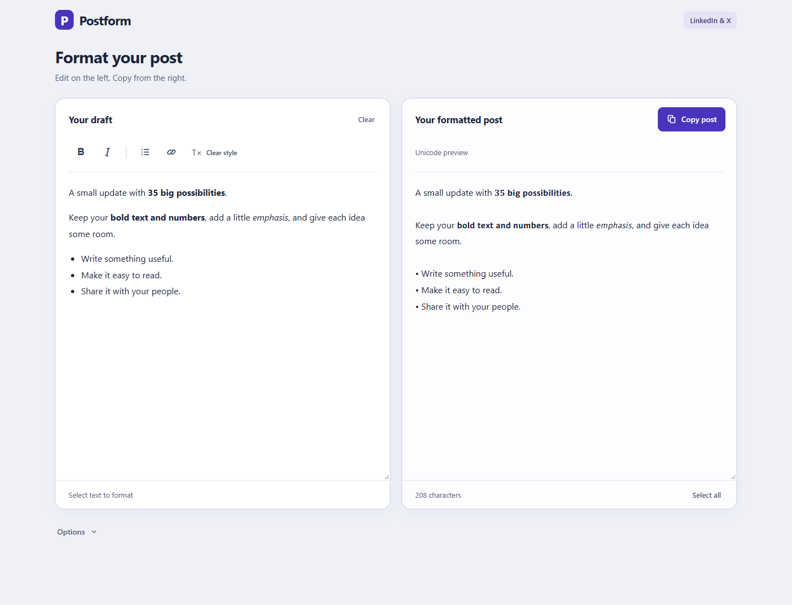

# Postform

A small offline formatter for LinkedIn and X. Paste a draft, keep its bold and italics, and copy the whole post with its spacing intact. Bold letters and numbers convert together.



## Use it

Download [Postform.html](dist/Postform.html) using GitHub’s **Download raw file** button, then open it in your browser. The app is one HTML file: no installation, account, or server required.

1. Paste Markdown or a formatted draft into the editor.
2. Edit visually. Select text to add bold, italics, lists, or links.
3. Click **Copy post**, then paste into LinkedIn or X.

Open **Options** when you want to change spacing, bold style, links, or plain text output. It also contains **Try an example**, **Save post as .txt**, and **Download app**. Ctrl/⌘B and Ctrl/⌘I format selected text; Ctrl/⌘Enter copies the post.

Drafts and settings stay in your browser’s local storage when available. There are no uploads, analytics, external scripts, or remote fonts. Local drafts can depend on the browser and file location.

## Formatting

- Bold, italic, combined bold italic, and bold numbers.
- Markdown headings, links, lists, inline code, and fenced code.
- Bold, italic, links, and lists pasted from common document editors.
- Social spacing, spaced lists, or your original line breaks.

Styled alphabets cover basic Latin letters. Accented letters, other scripts, and emojis stay as typed. Italic-only numbers stay normal because Unicode has no italic digit alphabet. URLs, email addresses, @mentions, hashtags, footnote markers, and code keep their original characters. Link destinations appear as visible URLs unless **Label only** is selected. The character counter measures Unicode code points; platform limits can differ. Unicode styled letters can be read differently by screen readers; **Plain text** provides an unstyled alternative.

## Develop

Requires Node.js 20 or later. The app and formatter tests need no installed packages.

```sh
npm run build
npm test
```

The build creates identical standalone files at `dist/Postform.html` and `dist/index.html`. Edit the files in `src/`, then rebuild.

For browser checks:

```sh
npm install
npx playwright install chromium
npm run test:browser
```

Set `PLAYWRIGHT_CHROMIUM_EXECUTABLE_PATH` to use an existing Chromium or Chrome executable instead. Browser screenshots and reports are written to `tests/artifacts/` and excluded from Git.

## GitHub Pages

The included deployment workflow publishes `dist/`. In repository **Settings → Pages**, choose **GitHub Actions** as the source. Then run **Deploy to GitHub Pages** from the **Actions** tab. Deployment runs only when manually requested. See [GitHub’s Pages workflow documentation](https://docs.github.com/en/pages/getting-started-with-github-pages/using-custom-workflows-with-github-pages).
